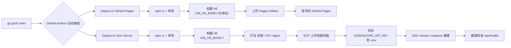

# 童伴成长 · 自动部署流程

本文档说明本项目**从提交代码到自动上线**的完整流程。项目同时维护两条部署流水线：

| 流水线 | 工作流文件 | 目标 | 触发方式 | 当前地址 |
| --- | --- | --- | --- | --- |
| GitHub Pages | `.github/workflows/deploy.yml` | 纯静态 H5（无后端） | push `main` / 手动 | <https://hewei-86.github.io/tongban_project/> |
| 自有云服务器 | `.github/workflows/deploy-server.yml` | H5 + FastAPI + Nginx（Docker） | push `main` / 手动 | <http://120.26.177.245/> |

> 一次 `git push` 会**同时触发两条**流水线：Pages 用于公开展示，服务器用于完整环境（含 API / AI 出题）。

---

## 目录

- [一、整体流程](#一整体流程)
- [二、GitHub Pages 流水线](#二github-pages-流水线)
- [三、云服务器流水线](#三云服务器流水线)
- [四、首次配置（只做一次）](#四首次配置只做一次)
- [五、日常发布](#五日常发布)
- [六、回滚](#六回滚)
- [七、服务器目录与数据](#七服务器目录与数据)
- [八、环境变量与密钥](#八环境变量与密钥)
- [九、验证部署结果](#九验证部署结果)
- [十、常见问题排查](#十常见问题排查)
- [十一、安全建议](#十一安全建议)
- [十二、按需调整流水线](#十二按需调整流水线)
- [十三、相关文件](#十三相关文件)

---

## 一、整体流程



两条流水线都会在**发布前跑前端单元测试**：测试不通过，构建和部署直接终止，线上保持旧版本。

| 阶段 | 大约耗时 |
| --- | --- |
| Pages | 40—70 秒 |
| 服务器 | 60—100 秒（取决于 Docker 构建缓存） |

---

## 二、GitHub Pages 流水线

文件：`.github/workflows/deploy.yml`

### 触发条件

- push 到 `main`
- 手动 `workflow_dispatch`

### 权限与并发

```yaml
permissions:
  contents: read
  pages: write
  id-token: write

concurrency:
  group: github-pages
  cancel-in-progress: true
```

同一时间只保留最新一次部署；新提交会取消正在排队的旧任务。

### 执行步骤

| 步骤 | 做什么 |
| --- | --- |
| Checkout | 拉取代码 |
| Setup Node.js | Node 20 + npm 缓存（`frontend/package-lock.json`） |
| Install dependencies | `npm ci` |
| Run unit tests | `npm test`（27 项） |
| Configure Pages | `actions/configure-pages@v5` |
| Resolve H5 base path | 自动计算资源前缀：项目站点为 `/仓库名/`；仓库名为 `<owner>.github.io` 时为 `/` |
| Build H5 | `UNI_H5_BASE=<base> npm run build:h5` |
| Prepare static files | 校验 `index.html`，写入 `.nojekyll` 和 `404.html` |
| Upload artifact | 上传 `frontend/dist/build/h5` |
| Deploy | `actions/deploy-pages@v4` 发布 |

### 子路径是怎么处理的

GitHub Pages 的「项目站点」地址是：

```text
https://<owner>.github.io/<repo>/
```

如果构建产物仍使用 `/assets/...` 绝对路径，打开就会白屏。工作流会自动计算并注入：

```text
UNI_H5_BASE=/<repo>/
```

部署后资源路径应为：

```text
/tongban_project/assets/xxx.js
```

> 绑定**自定义域名**后，站点会部署在根路径，需要把 `Resolve H5 base path` 步骤改为输出 `/`。

---

## 三、云服务器流水线

文件：`.github/workflows/deploy-server.yml`

### 触发条件

- push 到 `main`
- 手动 `workflow_dispatch`

### 权限与并发

```yaml
permissions:
  contents: read

concurrency:
  group: server-deploy
  cancel-in-progress: false
```

服务器部署是**串行**的：新提交排队等待上一次部署结束，避免两个部署同时操作 Docker 容器。

### 执行步骤

| 步骤 | 做什么 |
| --- | --- |
| Checkout / Node / npm ci | 与 Pages 一致 |
| Run unit tests | 发布前跑 27 项单测 |
| Build H5 | `UNI_H5_BASE=/`（服务器由 Nginx 托管在根路径） |
| Verify H5 build | 检查 `index.html` 是否存在 |
| Setup SSH | 写入私钥、`ssh-keyscan` 记录主机指纹 |
| Package artifacts | 打三个包：`backend.tar.gz`、`h5.tar.gz`、`infra.tar.gz`（`docker-compose.yml` + `nginx/`） |
| Upload to server | `scp` 到服务器 `/tmp` |
| Sync AI key | 如果配置了 `DASHSCOPE_API_KEY`，写入服务器 `.env`（保留其它配置） |
| Deploy on server | SSH 执行：解压 → 保留 `.env` → 重建容器 → 健康检查 |

### 服务器端实际执行内容

```text
1. 解压基础设施（docker-compose.yml、nginx/nginx.conf）
2. 如果 .env 不存在，创建占位文件
3. 解压后端代码到 backend/（保留数据库卷和 .env）
4. 清空并解压新 H5 到 frontend/site/
5. docker compose down --remove-orphans
6. docker compose build backend
7. docker compose up -d
8. 轮询 http://127.0.0.1/api/health 与 http://127.0.0.1/
9. 清理 /tmp 临时包
```

### 部署后的容器结构

```text
                公网 :80
                   │
            ┌──────▼──────┐
            │  tongban-nginx  │  托管 H5 + 反向代理 /api/
            └──────┬──────┘
                   │ 容器内网 :8000
            ┌──────▼──────┐
            │ tongban-backend │  FastAPI，不对外暴露 8000
            └──────┬──────┘
                   │
            ┌──────▼──────┐
            │  tongban-data   │  Docker 卷，保存 SQLite
            └─────────────┘
```

- 后端 8000 **不对公网开放**（`docker-compose.yml` 只 `expose`，没有 `ports`）
- 静态资源由 Nginx 直接返回
- 数据库在 Docker 卷 `tongban-data` 中，重新部署不丢数据

---

## 四、首次配置（只做一次）

### 4.1 GitHub 仓库 Secrets

打开仓库：**Settings → Secrets and variables → Actions → New repository secret**

| Secret | 必填 | 说明 |
| --- | --- | --- |
| `SERVER_HOST` | 是 | 服务器 IP 或域名，例如 `120.26.177.245` |
| `SERVER_USER` | 是 | SSH 用户名，例如 `root` / `ubuntu` |
| `SERVER_SSH_KEY` | 是 | 部署用**私钥全文**（`-----BEGIN ... KEY-----`） |
| `DEPLOY_PATH` | 否 | 服务器部署目录，默认 `/data/myproject` |
| `DASHSCOPE_API_KEY` | 否 | 通义千问 Key；配置后 AI 出题才会真正调用大模型 |

### 4.2 生成部署专用 SSH 密钥（本地）

```bash
ssh-keygen -t ed25519 -C "github-actions-tongban" -f ~/.ssh/github_actions_tongban -N ""
```

- **私钥**（`~/.ssh/github_actions_tongban`）内容 → 填到 `SERVER_SSH_KEY`
- **公钥**（`.pub`）追加到服务器的 `~/.ssh/authorized_keys`

Windows PowerShell 读取私钥内容：

```powershell
Get-Content ~/.ssh/github_actions_tongban -Raw | Set-Clipboard
```

### 4.3 服务器准备

要求：Linux（推荐 Ubuntu 22.04+）、Docker + Compose 插件、开放 80 端口。

```bash
# 安装 Docker（如未安装）
curl -fsSL https://get.docker.com | sh
systemctl enable --now docker

# 放行 80（有防火墙时）
ufw allow 80/tcp

# 建部署目录
mkdir -p /data/myproject

# 配置登录公钥
mkdir -p ~/.ssh && chmod 700 ~/.ssh
echo "ssh-ed25519 AAAA... github-actions-tongban" >> ~/.ssh/authorized_keys
chmod 600 ~/.ssh/authorized_keys
```

验证：

```bash
ssh -i ~/.ssh/github_actions_tongban <SERVER_USER>@<SERVER_HOST> "docker compose version"
```

### 4.4 启用 GitHub Pages

1. 仓库 **Settings → Pages**
2. **Build and deployment → Source** 选择 **GitHub Actions**
3. 保存即可（工作流令牌没有创建 Pages 站点的权限，必须由仓库管理员开启）

### 4.5 配置 AI 出题（可选）

1. 在 [阿里云百炼](https://bailian.console.aliyun.com/) 创建 API Key
2. 把 Key 加入 GitHub Secret：`DASHSCOPE_API_KEY`
3. 触发一次部署，工作流会把它写入服务器 `.env` 并重启后端
4. 打开「练习 → AI 出题」，提示“AI 已生成新题（通义千问）”即生效

> Pages 站点没有后端，会自动回退本地题库；AI 出题只在服务器站点生效。

---

## 五、日常发布

### 5.1 标准流程

```bash
git add -A
git commit -m "feat: 你的改动"
git push origin main
```

推送后：

1. 打开仓库 **Actions** 页面
2. 会看到两条工作流在跑：
   - `Deploy to GitHub Pages`
   - `Deploy to Own Server`
3. 等两条都变绿即可（约 1—2 分钟）

### 5.2 只部署其中一个

- **Actions → Deploy to GitHub Pages → Run workflow**
- **Actions → Deploy to Own Server → Run workflow**

手动触发同样会跑测试，可指定分支（默认 `main`）。

### 5.3 发布前本地自检（推荐）

```bash
cd frontend
npm test          # 27 项单测
npm run build:h5  # 产物在 dist/build/h5
```

```bash
cd backend
.venv\Scripts\python.exe test_api.py   # 39 项接口自测（Windows）
```

---

## 六、回滚

### 6.1 代码回滚

```bash
# 找到问题提交
git log --oneline -5

# 回退（保留历史）
git revert <bad-commit> --no-edit
git push origin main
```

推送后两条流水线会自动重新部署到上一个正确版本。

### 6.2 只重跑某次部署

GitHub Actions 的 **Re-run jobs** 只会重跑同一提交，不会回退代码；要回滚请用上面的 `git revert`。

### 6.3 数据说明

- 回滚代码**不会**删除服务器数据库（Docker 卷 `tongban-data`）
- 前端数据本来就在用户浏览器本地，回滚不影响
- 如需备份服务器数据库：

```bash
# 先确认实际卷名（通常带 compose 项目前缀）
docker volume ls | grep tongban

# 用实际卷名替换下面的 <volume-name>
docker run --rm -v <volume-name>:/data -v $(pwd):/backup alpine \
  tar czf /backup/tongban-data.tar.gz -C /data .
```

---

## 七、服务器目录与数据

部署后的目录（默认 `/data/myproject`）：

```text
/data/myproject/
├─ docker-compose.yml
├─ nginx/
│  └─ nginx.conf
├─ backend/               # FastAPI 代码（每次部署覆盖）
├─ frontend/
│  └─ site/               # H5 静态文件（每次部署清空后覆盖）
└─ .env                   # 密钥与配置（保留，不随部署覆盖）
```

持久化数据：

| 数据 | 位置 |
| --- | --- |
| SQLite 数据库 | Docker 卷 `tongban-data`（实际卷名会带 Compose 项目前缀，如 `myproject_tongban-data`）→ 容器 `/app/data/tongban.db` |
| 环境变量 / Key | `/data/myproject/.env` |
| 前端静态文件 | `/data/myproject/frontend/site`（可随时重建） |

查看状态：

```bash
cd /data/myproject
docker compose ps
docker compose logs --tail=100 backend
docker compose logs --tail=50 nginx
```

---

## 八、环境变量与密钥

### 8.1 工作流使用的 Secrets

见 [4.1](#41-github-仓库-secrets)。

### 8.2 服务器 `.env`

首次部署会自动创建占位内容：

```env
DASHSCOPE_API_KEY=
QWEN_MODEL=qwen-turbo
```

修改模型（例如换成 `qwen-plus`）：

```bash
cd /data/myproject
sed -i 's/^QWEN_MODEL=.*/QWEN_MODEL=qwen-plus/' .env
docker compose up -d backend
```

> `DASHSCOPE_API_KEY` 在配置了 GitHub Secret 时由工作流自动同步，手工修改会被下次部署覆盖。
> 其它变量（如 `QWEN_MODEL`）不会被覆盖。

### 8.3 密钥安全

- `.env`、数据库、私钥**都不在仓库里**（见 `.gitignore`）
- Actions 日志会自动打码 Secret，但仍不建议在脚本里 `echo` 密钥
- 部署私钥建议**只用于这台服务器**，不要复用个人主密钥

---

## 九、验证部署结果

### 9.1 Pages

```bash
curl -I https://hewei-86.github.io/tongban_project/
```

- 200 且资源路径为 `/tongban_project/assets/...`
- 浏览器打开能正常看到首页

### 9.2 服务器

```bash
# 前端
curl -I http://120.26.177.245/

# 后端（经 Nginx 代理）
curl http://120.26.177.245/api/health
# 期望：{"ok":true,"service":"tongban-api",...}

# 确认后端端口没有对公网暴露（应当超时/拒绝）
curl -m 5 http://120.26.177.245:8000/api/health

# 确认 AI Key 是否生效
curl -s -X POST http://120.26.177.245/api/ai/chat \
  -H "Content-Type: application/json" \
  -d '{"user_id":2,"grade":1,"message":"8+7等于几"}'
# 期望：ai_enabled:true（未配置时为 false，返回演示回复）
```

### 9.3 版本确认

页面「我的 → 关于童伴」显示当前版本号；或查看线上 JS 中的 `appVersion`。

---

## 十、常见问题排查

| 现象 | 可能原因 | 处理 |
| --- | --- | --- |
| Pages 打开白屏、控制台 404 `/assets/...` | 构建 base 不对 | 确认仓库是项目站点；重新跑工作流；自定义域名需把 base 改为 `/` |
| Actions 报 `Get Pages site failed` | Pages 未开启或 Source 不是 GitHub Actions | Settings → Pages → Source 选 **GitHub Actions**，再重跑 |
| Pages 部署 404 | 分支不是 `main` 或 Pages 未发布 | 检查分支名与 Pages 设置 |
| 服务器步骤 `Permission denied (publickey)` | 私钥/用户不匹配 | 本地用同一私钥 `ssh -i` 登录验证；检查 `SERVER_USER` |
| `Host key verification failed` | 服务器指纹变化 | 工作流已 `ssh-keyscan`；若服务器重装需更新已知主机 |
| `docker: command not found` / `docker compose` 报错 | 服务器未装 Docker/Compose | 按 [4.3](#43-服务器准备) 安装 |
| `port is already allocated` | 80 端口被占用 | `ss -ltnp \| grep :80` 找到占用服务并停止，或改用其它端口 |
| 健康检查失败 `backend API FAILED` | 后端启动异常 | 工作流日志会输出 `docker compose logs --tail=30 backend`；本地 `docker compose logs` 排查 |
| 网站能开但接口 502 | 后端容器未起来 | `docker compose ps` / `docker compose logs backend` |
| AI 出题没有调用大模型 | 未配置 `DASHSCOPE_API_KEY`，或 Key 无效 | 检查 Secret、重新部署、查 `/api/ai/chat` 的 `ai_enabled` |
| 配置 Key 后仍提示未配置 | 工作流未同步（Secret 为空/部署未跑） | 重跑 `Deploy to Own Server`，查看 `Sync AI key` 步骤日志 |
| 每次改 README 也会重新部署 | 工作流未设置路径过滤 | 见 [12.2](#122-只在前端或后端变更时部署) |
| `npm ci` 失败 | `package-lock.json` 与 `package.json` 不一致 | 本地执行 `npm install` 生成新 lockfile 后提交 |

查看完整日志：

```text
GitHub → Actions → 选择运行记录 → Jobs → 展开失败步骤
```

服务器端手动复现：

```bash
cd /data/myproject
docker compose down --remove-orphans
docker compose build backend
docker compose up -d
docker compose ps
curl -s http://127.0.0.1/api/health
```

---

## 十一、安全建议

1. **使用独立部署密钥**，只授权这台服务器；不要复用个人 SSH 主密钥。
2. **不要提交** `.env`、数据库、部署私钥（`.gitignore` 已处理，仍建议提交前 `git status` 检查）。
3. **后端端口不对公网开放**：当前只通过 Nginx 代理 `/api/`，不要加回 `8000:8000` 端口映射。
4. **尽快启用 HTTPS**：当前服务器站点是 `http://`，浏览器会提示不安全，账号密码也会走较弱的回退哈希；建议域名解析到服务器后配置 Certbot / Caddy。
5. **最小权限**：能用非 root 用户部署就不要用 root；给部署目录单独授权。
6. **定期备份** `tongban-data` 卷与 `.env`。
7. **Secret 轮换**：Key 泄露时立即在百炼控制台删除旧 Key，并更新 GitHub Secret。

---

## 十二、按需调整流水线

### 12.1 修改部署分支

两个工作流都在这里配置：

```yaml
on:
  push:
    branches:
      - main   # 改成你的分支名
```

### 12.2 只在前端或后端变更时部署

如果不想改文档也触发服务器部署，可在 `deploy-server.yml` 的 `push` 下加路径过滤：

```yaml
on:
  push:
    branches: [main]
    paths:
      - 'frontend/**'
      - 'backend/**'
      - 'nginx/**'
      - 'docker-compose.yml'
      - '.github/workflows/deploy-server.yml'
  workflow_dispatch:
```

> 注意：加了过滤后，只有 `.env` 或 Secret 变化不会触发部署；需要手动 Run workflow。

### 12.3 新增一个环境变量

1. 在 GitHub 添加 Secret（如 `QWEN_MODEL`）
2. 在 `deploy-server.yml` 增加同步逻辑（参考 `Sync AI key to server`）
3. 或直接在服务器 `.env` 里维护，重启后端生效

### 12.4 绑定域名 + HTTPS

1. 域名 A 记录解析到服务器 IP
2. 服务器安装反向代理 / 证书（Caddy 最省事，或 Nginx + Certbot）
3. Nginx 增加 443 server 块并挂载证书
4. `docker-compose.yml` 增加 443 端口映射与证书卷
5. Pages 如果也用自定义域名，记得把 base 改成 `/`

---

## 十三、相关文件

| 文件 | 作用 |
| --- | --- |
| `.github/workflows/deploy.yml` | GitHub Pages 自动部署 |
| `.github/workflows/deploy-server.yml` | 云服务器自动部署 |
| `frontend/package.json` | 前端构建与测试脚本 |
| `frontend/vite.config.js` | H5 base、开发代理 |
| `backend/test_api.py` | 后端接口自测 |
| `docker-compose.yml` | 服务器容器编排（Nginx + FastAPI） |
| `nginx/nginx.conf` | 静态托管与 `/api/` 反向代理 |
| `.env.example` | 环境变量示例 |
| `README.md` | 项目说明与本地运行 |

---

## 附：最短上手清单

```text
□ 仓库 Settings → Pages → Source = GitHub Actions
□ 添加 Secrets：SERVER_HOST / SERVER_USER / SERVER_SSH_KEY
□ 服务器装 Docker，开放 80，部署公钥加入 authorized_keys
□ git push origin main
□ Actions 两条流水线变绿
□ 访问 Pages 与服务器地址验证
```
