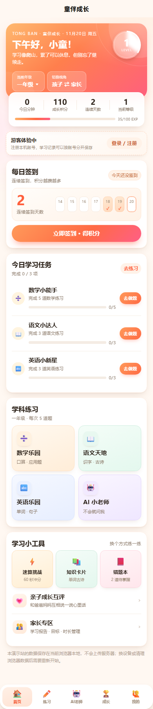
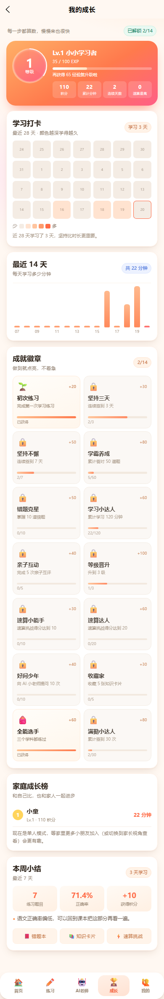

# 童伴成长 · AI 学习与亲子陪伴练习站

面向小学 **1—3 年级** 的 AI 学习助手与亲子陪伴练习站：学科练习、速算挑战、知识卡片、错题本、成长成就、亲子互评、家长报告。支持**云端账号（MySQL 多端同步）**与**本机账号 / 游客**两种模式，账号之间数据隔离。

前端基于 **uni-app + Vue 3**，内置一套**本地数据引擎**，所以可以**纯静态部署**（GitHub Pages 免费上线），不需要服务器和数据库；仓库里同时保留了可选的 FastAPI 后端与 Docker 部署方案。

<p>
  <a href="https://github.com/hewei-86/tongban_project/actions/workflows/deploy.yml"></a>
  <a href="https://hewei-86.github.io/tongban_project/"></a>
  
  
</p>

> **在线体验**
>
> - GitHub Pages 演示版：<https://hewei-86.github.io/tongban_project/>（无需登录，本机数据）
> - 自有服务器产品版：<http://120.26.177.245/>（云端账号 + MySQL 多端同步，需注册登录）

<p>
  
  
  
</p>
<p>
  
  
  
</p>

---

## 目录

- [功能一览](#功能一览)
- [项目说明与商业化方案（PROJECT.md）](PROJECT.md)
- [账号与数据模式](#账号与数据模式)
- [本地运行](#本地运行)
- [部署到 GitHub Pages（推荐）](#部署到-github-pages推荐)
- [自动部署流程（DEPLOY.md）](DEPLOY.md)
- [目录结构](#目录结构)
- [数据与隐私](#数据与隐私)
- [可选：FastAPI 后端](#可选fastapi-后端)
- [构建微信小程序](#构建微信小程序)
- [测试](#测试)
- [常见问题](#常见问题)
- [后续计划](#后续计划)

---

## 功能一览

| 页面 | 能力 |
| --- | --- |
| 🏠 首页 | 每日签到、连续天数、今日任务进度、年级切换、孩子 / 家长视角切换、每日一句 |
| ✏️ 学科练习 | 数学 / 语文 / 英语 3 科 × 1—3 年级，共 **189 道固定题**（含 45 道教材同步样板），逐题作答与讲解，答错自动进错题本；「AI 出题」在服务器部署时调用通义千问生成新题，纯静态环境自动回退本地题库 |
| 📚 教材同步 | 河北保定 · 人教版三年级上册数学样板：9 个单元、45 道原创同步题，按单元练习与单元进度 |
| ⚡ 速算挑战 | 60 秒限时口算，连击加分，最高分记录，成绩计入积分与成长曲线 |
| 📚 知识卡片 | 英语单词闪卡（点开看释义）、单词/例句朗读、8 首古诗、10 个成语、收藏夹 |
| 🤖 AI 小老师 | 服务器版调用通义千问做题目解析 / 分步讲解；带最近对话和学习档案（年级、薄弱点、错题）；本地 / Pages 回退规则引擎；支持语音输入（需 HTTPS）和回答朗读 |
| 📕 错题本 | 待掌握 / 已掌握筛选，重做判题，答对自动标记掌握，支持删除 |
| 🏆 我的成长 | 等级与经验、连续签到、28 天学习热力图、14 天学习曲线、14 个成就徽章、家庭成长榜、本周小结 |
| 💗 亲子互评 | 默契度、5 星评价、鼓励留言、互评记录 |
| 👨‍👩‍👧 家长中心 | 孩子概况、周报 / 月报、学科正确率、每日学习曲线、自动生成的小建议、学习目标、每日时长管理 |
| 🌟 会员中心 | 家庭会员、权益说明、兑换码开通、今日 AI 额度 |
| ⚔️ 真人 PK | 1v1 随机匹配、5 题、服务端计时判分、速度加分；结算页展示胜利者/失败者名称与分数、撒花动画 |
| 🛠️ 管理后台 | 独立 `/admin/`：数据概览、用户/停用、手动开通会员、兑换码、题库、PK 对局、审计 |
| 🔐 登录 / 注册 | 服务器版：云端账号 + JWT + MySQL 多端同步；Pages 演示版：本机账号 / 游客 |
| 🙋 我的 | 账号信息、会员入口、角色切换、年级切换、数据导出 / 导入 / 重置、隐私与项目说明 |

设计上的几个小坚持：

- **不排名、不贴标签**：报告只描述趋势，并给出可执行的鼓励建议；
- **数据模式可选**：服务器版写入 MySQL 并支持多端同步；Pages 演示版只存浏览器，不上传；
- **AI 坦白身份**：明确告知「我是程序，不是真人老师」，重要知识提示再找家长或老师核对；
- **离线可用**：不依赖任何外部 API，弱网也能练习。

---

## 账号与数据模式

项目支持两种构建模式，由 `VITE_DATA_MODE` 决定（部署工作流会自动设置）：

| 模式 | 适用站点 | 账号 | 数据 |
| --- | --- | --- | --- |
| `remote` | 自有服务器 | 后端注册 / 登录，JWT | MySQL，按账号隔离，多端同步 |
| `local` | GitHub Pages / 本地 | 浏览器本机账号或游客 | 浏览器 localStorage，不上传 |

### 云端模式（服务器版）

- **账号**：后端注册 / 登录，密码用随机盐 + **PBKDF2-SHA256（12 万次迭代）** 哈希保存；JWT 有效期 30 天
- **数据隔离**：每个账号在 MySQL `user_states` 中有一条独立快照，接口从 JWT 取 `user_id`，不信任前端传参
- **同步**：登录拉取最新数据 → 本地缓存；修改后 800ms 防抖上传；回到前台 / 每 30 秒拉取一次；多端同时修改时返回 409 并刷新到服务端版本
- **强制登录**：服务器版未登录会跳到登录页
- **换设备**：登录同一账号即可恢复学习记录、错题、AI 对话、目标、收藏
- **当前限制**：数据是账号级 JSON 快照，还没有拆成题目 / 答题记录等关系表；多设备同时编辑采用“后写覆盖 + 冲突提示”，后续可升级为按实体同步

### 本机模式（Pages 演示）

| 项目 | 说明 |
| --- | --- |
| 账号存储 | 浏览器本地（`tongban_accounts_v1`），不会上传 |
| 密码处理 | 随机盐 + PBKDF2-SHA256，只保存哈希；不支持 WebCrypto 时退化为加盐 SHA-256 |
| 数据隔离 | 每个账号独立存储键，例如 `tongban_state_v1:acct_xxx` |
| 游客模式 | 不登录也能用，使用默认演示数据；注册后从空白数据开始 |
| 换设备 | 无法登录同一账号，需要重新注册 |

> 演示版用于快速体验；需要跨设备同步时请使用服务器版。不要在任何版本使用你在其它网站的真实密码。

---

## 本地运行

环境要求：**Node.js 20 LTS+**（本项目在 Node 24 上验证）。

```bash
cd frontend
npm install
npm run dev:h5      # 打开终端提示的本地地址（默认 http://localhost:5173）
```

打包静态站点：

```bash
npm run build:h5    # 产物在 frontend/dist/build/h5
```

本地预览打包结果（任选其一）：

```bash
npx serve dist/build/h5
# 或
python -m http.server 8080 --directory dist/build/h5
```

> 项目不需要配置 `.env`、数据库或 API Key，装完依赖即可使用。

---

## 部署到 GitHub Pages（推荐）

推送到 `main` 分支后，`.github/workflows/deploy.yml` 会自动构建并发布。

> 完整的自动部署流程（Pages + 自建服务器、首次配置 Secrets、回滚、排错、HTTPS）见 **[DEPLOY.md](DEPLOY.md)**。

### 第一次部署（只需要做一次）

1. 把项目推到 GitHub 仓库（默认分支 `main`）。
2. 打开仓库 **Settings → Pages → Build and deployment**，把 **Source** 设为 **GitHub Actions**。
3. 回到 **Actions** 页面，等待 `Deploy to GitHub Pages` 跑完。
4. 访问：

```text
https://<你的用户名>.github.io/<仓库名>/
```

例如本仓库：<https://hewei-86.github.io/tongban_project/>

### 它是怎么处理子路径的

GitHub Pages 的「项目站点」部署在 `/<仓库名>/` 下，如果资源路径仍是 `/assets/...` 就会白屏。工作流会自动计算并注入：

```yaml
UNI_H5_BASE: /<仓库名>/
```

- 仓库名形如 `<用户名>.github.io` 时，自动使用根路径 `/`；
- 工作流还会写入 `.nojekyll` 和 `404.html` 兜底。

### 绑定自定义域名

在 **Settings → Pages → Custom domain** 填写域名后，站点会部署在根路径，此时需要把工作流里的 base 改成 `/`：

```yaml
# .github/workflows/deploy.yml 的 Resolve H5 base path 步骤
echo "value=/" >> "$GITHUB_OUTPUT"
```

### 部署后白屏 / 404 排查

| 现象 | 原因 | 处理 |
| --- | --- | --- |
| 打开空白、控制台 404 `/assets/...` | base 不对 | 确认上面「Source」为 GitHub Actions；重新运行工作流 |
| 页面 404 | Pages 未启用或分支不是 `main` | 检查 Settings → Pages；确认推送到 `main` |
| Actions 报 `Get Pages site failed` | Pages 还没开启 | 先按上面第 2 步开启，再重跑 |
| 样式正常但数据为空 | 浏览器清理了本地数据 | 正常现象，本地数据模式不做云端同步 |

---

## 目录结构

```text
tongban_project/
├─ frontend/                        # uni-app（Vue 3）前端
│  ├─ src/
│  │  ├─ pages/                     # 15 个页面（含教材同步、会员中心、真人 PK）
│  │  │  ├─ index/                  # 首页
│  │  │  ├─ practice/               # 学科练习
│  │  │  ├─ curriculum/             # 教材同步（河北保定样板）
│  │  │  ├─ challenge/              # 速算挑战
│  │  │  ├─ cards/                  # 知识卡片
│  │  │  ├─ ai/                     # AI 小老师
│  │  │  ├─ wrongbook/              # 错题本
│  │  │  ├─ growth/                 # 成长档案
│  │  │  ├─ family/                 # 亲子互评
│  │  │  ├─ parent/                 # 家长中心
│  │  │  ├─ settings/               # 我的（含账号入口）
│  │  │  └─ auth/                   # 登录 / 注册
│  │  ├─ components/TabBar.vue      # 自定义底部导航（孩子 / 家长两套）
│  │  ├─ services/                  # 数据引擎、AI 小老师、账号、同步、接口门面
│  │  │  ├─ auth.js                 # 注册 / 登录 / 退出（按模式切换本机 / 云端）
│  │  │  ├─ accounts.js             # 本机账号列表（local 模式）
│  │  │  ├─ password.js             # PBKDF2 / SHA-256 密码处理（local 模式）
│  │  │  ├─ remoteAuth.js           # 云端注册 / 登录 / JWT（remote 模式）
│  │  │  ├─ stateSync.js            # MySQL 快照同步（防抖、版本冲突）
│  │  │  ├─ remoteAi.js             # 服务器「AI 出题」客户端（含本地回退）
│  │  │  └─ engine.js               # 账号可切换的数据引擎单例
│  │  ├─ config.js                  # DATA_MODE（local / remote）与 API_BASE
│  │  ├─ data/                      # 题库、知识卡片数据
│  │  ├─ styles/app.css             # 设计系统（颜色、卡片、按钮、表单）
│  │  ├─ pages.json / manifest.json # 路由与打包配置
│  │  └─ App.vue / main.js
│  ├─ tests/                        # 29 项单测（引擎 + 账号密码）
│  └─ vite.config.js
├─ backend/                         # 产品版 FastAPI 后端
│  ├─ main.py / models.py / schemas.py / database.py / security.py
│  ├─ membership.py / admin_api.py / membership_api.py
│  ├─ pk_api.py / pk_bank.py         # 真人 PK WebSocket 与服务端题库
│  ├─ test_api.py                   # 45 项鉴权 / 会员 / PK / 同步自测
│  ├─ requirements.txt / Dockerfile
│  └─ .env                           # 本地配置（不提交）
├─ admin/                            # 独立管理后台（Vue 3 + Vite，部署到 /admin/）
│  ├─ src/App.vue / styles.css
│  └─ package.json / vite.config.js
├─ nginx/nginx.conf                 # 服务器部署用（/api、/ws 反代）
├─ docker-compose.yml               # MySQL + 后端 + Nginx
├─ docs/                            # README 预览图
├─ PROJECT.md                       # 项目说明、痛点、商业模式、讲解稿
├─ DEPLOY.md                        # 自动部署完整流程（Pages + 云服务器 + 回滚 + 排错）
├─ .env.example                     # 环境变量示例（MySQL / JWT / AI Key）
└─ .github/workflows/
   ├─ deploy.yml                    # GitHub Pages 自动部署（local 演示模式）
   └─ deploy-server.yml             # 部署到自己的服务器（remote 模式，push main 自动）
```

---

## 数据与隐私

- **服务器版**：账号与学习快照保存在 MySQL；密码只保存随机盐与哈希；浏览器保留一份本地缓存用于弱网和快速打开；
- **Pages 演示版**：数据只在浏览器 localStorage；游客使用 `tongban_state_v1`，本机账号使用 `tongban_state_v1:acct_xxx`；
- 云端同步只传输学习数据（积分、记录、错题、对话等），不包含密码；
- 「我的 → 账号数据」支持**导出备份 / 导入数据 / 重置**（作用于当前账号；云端模式会同步到 MySQL）；
- AI 小老师在服务器版会把问题、最近几轮对话和一份学习档案（年级、薄弱点、最近错题）发给通义千问做解析 / 讲解，并把这一轮对话存进学习数据；档案不包含姓名、学校、电话等隐私；本地 / Pages 使用规则引擎；
- 「AI 出题」会把年级、学科和数量发给后端 / 通义千问；不发送账号密码；
- 目前不采集微信登录、手机号、真实姓名等信息。

> ⚠️ 如果作为**面向真实儿童的产品**上线，还需要补充：监护人授权与同意流程、儿童隐私政策、内容安全审核、ICP 备案、未成年人保护与数据安全评估等。当前是产品原型，不应直接用于真实儿童的大规模使用。

---

## 后端与 MySQL

`backend/` 是产品版 API，提供：

| 接口 | 作用 |
| --- | --- |
| `POST /api/auth/register` | 注册，返回 JWT |
| `POST /api/auth/login` | 登录，返回 JWT |
| `GET /api/auth/me` | 当前账号 |
| `GET /api/state` | 拉取当前账号的学习数据快照 |
| `PUT /api/state` | 上传数据（`base_version` 版本检测，冲突返回 409） |
| `POST /api/practice/generate` | 通义千问生成练习题（需登录，按会员额度限制） |
| `POST /api/ai/chat` | AI 解析 / 分步讲解（需登录，与出题共用额度） |
| `GET /api/membership/status` | 会员状态、到期时间、今日 AI 额度 |
| `POST /api/membership/redeem` | 兑换码开通会员 |
| `POST /api/admin/login` | 管理员登录 |
| `GET /api/admin/dashboard` | 后台概览 |
| `GET /api/admin/users` | 用户列表 / 搜索 / 停用 / 手动开通会员 |
| `POST /api/admin/redeem-codes` | 生成会员兑换码 |
| `GET /api/admin/questions` | 题库管理（PK 使用） |
| `GET /api/admin/pk/matches` | PK 对局记录 |
| `WS /ws/pk` | 1v1 真人 PK（token 鉴权、服务端判分） |
| `GET /api/health` | 健康检查 |

- 鉴权：`Authorization: Bearer <JWT>`；所有数据接口都只操作 token 对应账号
- 存储：MySQL 8（本地开发可退回 SQLite），账号表 `users` + 快照表 `user_states` + 会员/兑换码/题库/PK 表
- 当前学习数据仍是账号级 JSON 快照；后台统计与 PK 使用新增的关系表

### 本地启动

```bash
cd backend
uv sync                                   # 或者 python -m venv .venv && pip install -r requirements.txt
cp ../.env.example .env                   # 本地默认 SQLite；需要 AI 时填 DASHSCOPE_API_KEY
uv run uvicorn main:app --reload --port 8000
```

- 健康检查：<http://127.0.0.1:8000/api/health>
- 接口文档：<http://127.0.0.1:8000/docs>

没有 `DASHSCOPE_API_KEY` 时，AI 接口会返回明确标注的演示回复，不影响其它功能。

### 启用真实 AI 出题（通义千问）

服务器部署时，练习页的「AI 出题」会自动调用后端，由通义千问按年级和学科生成新题：

1. 在 [阿里云百炼](https://bailian.console.aliyun.com/) 创建 API Key（需要开通百炼服务）；
2. 打开 GitHub 仓库 **Settings → Secrets and variables → Actions**，新建 Secret：`DASHSCOPE_API_KEY`；
3. 推送任意提交（或在 Actions 手动运行 **Deploy to Own Server**），工作流会把 Key 同步到服务器 `/data/myproject/.env` 并重启后端；
4. 打开服务器站点 →「练习」→「AI 出题」，成功时会提示“AI 已生成新题（通义千问）”。

说明：

- GitHub Pages 没有后端，会自动回退本地题库，不影响使用；
- 本地开发时 `npm run dev:h5` 会把 `/api` 代理到 `127.0.0.1:8000`，可以直接测试；
- 未配置 Key、额度不足或请求超时都会自动回退本地题库；
- 默认模型是 `qwen-turbo`，可在服务器 `.env` 中修改 `QWEN_MODEL`（例如 `qwen-plus`），费用以百炼控制台为准。

### 接口自测

```bash
cd backend
.venv\Scripts\python.exe test_api.py      # Windows
python test_api.py                        # macOS / Linux
```

脚本使用临时数据库，不会污染 `tongban.db`；当前覆盖 **45 项**检查（注册、登录、JWT、账号隔离、版本冲突、会员兑换码、停用账号、PK 接口、AI 讲解 / 出题共用额度、429 限额、密码不明文）。

### 用 Docker 部署（MySQL + 后端 + Nginx）

`docker-compose.yml` 包含三个服务：

| 服务 | 说明 |
| --- | --- |
| `mysql` | MySQL 8.0，数据在 Docker 卷 `tongban-mysql`，字符集 utf8mb4 |
| `backend` | FastAPI，仅容器内网 8000，不直接暴露公网 |
| `nginx` | 托管 H5，`/api/` 反向代理到后端 |

服务器需要：Linux（推荐 Ubuntu 22.04+）、Docker + Compose、开放 80（配置 HTTPS 后再加 443）。

```bash
# 服务器首次部署
cd /data/myproject
# .env 中的 MYSQL_* / JWT_SECRET 由自动部署工作流生成并保留
docker compose up -d --build
```

- 数据持久化在 `tongban-mysql` 卷；重新部署不会丢
- 自动部署会**先构建后端、等 MySQL 健康、校验账号密码**，再滚动替换后端和 Nginx，不会先停掉整站
- 服务器版构建时设置 `VITE_DATA_MODE=remote`，前端强制登录并连 MySQL；GitHub Pages 构建保持 `local` 演示模式
- 部署失败时会保留旧容器继续服务；MySQL 密码与数据卷不一致时会中止并报错，避免把库写坏

需要域名 + HTTPS 时，可以用 Certbot 在宿主机签发证书，再把 443 反代到 80；或使用 Caddy。上线前请把 `.env` 和 MySQL 卷纳入备份。

完整步骤（Secrets、SSH、MySQL 密码、滚动部署、回滚、排错）见 **[DEPLOY.md](DEPLOY.md)**。

### 管理后台与会员

- 后台地址：`http://<服务器>/admin/`
- 账号由服务器 `.env` 的 `ADMIN_USERNAME` / `ADMIN_PASSWORD` 初始化，首次部署自动生成：

```bash
ssh root@<服务器>
cd /data/myproject
grep '^ADMIN_USERNAME=' .env
grep '^ADMIN_PASSWORD=' .env
```

- 后台能力：数据概览、用户搜索/停用、手动开通会员、生成兑换码、题库管理、PK 对局记录
- 会员：免费版每天 5 次、家庭会员每天 100 次 **AI 解析 / 出题 / 讲解共用额度**；99 元/年，当前用兑换码开通（未接在线支付）
- 家长端「我的 → 会员」输入兑换码即可开通
- 真人 PK：`WS /ws/pk`，1v1 随机匹配 5 题，服务端计时判分；Nginx 已配置 WebSocket 升级

### 语音输入与朗读

- AI 小老师输入框左侧有麦克风按钮，使用浏览器 **Web Speech API** 把普通话转成文字
- 麦克风需要 **HTTPS + 麦克风权限**；当前 `http://` 访问时点击会提示“语音输入需要 HTTPS”
- 每条 AI 回答下方有 **🔊 朗读** 按钮，用浏览器 `speechSynthesis` 朗读讲解；再点一次停止
- 朗读不需要 HTTPS，推荐 Chrome / Edge；Safari 的语音能力因系统版本而异
- 语音识别由浏览器/系统服务完成，音频不经过童伴后端；正式产品仍需在隐私政策中说明并取得监护人同意

---

## 构建微信小程序

```bash
cd frontend
npm run build:mp-weixin
```

用微信开发者工具导入 `frontend/dist/build/mp-weixin`，在 `src/manifest.json` 填写自己的 `mp-weixin.appid`。

小程序端默认使用本机账号与本地数据（`local` 模式）；正式发布还需要配置合法域名、隐私协议与内容审核。

---

## 测试

前端（数据引擎、AI 规则、账号密码、等级算法、报告统计等）：

```bash
cd frontend
npm test
# 29 项全部通过（19 项引擎 + 10 项账号 / 密码）
```

后端（鉴权、账号隔离、状态同步、AI 降级等）：

```bash
cd backend
.venv\Scripts\python.exe test_api.py
# 45 项全部通过
```

---

## 常见问题

**Q：为什么注册后学习数据是空的？**
A：新账号从空白数据开始，避免把演示记录或别人的数据算成自己的。服务器版会在 MySQL 中新建一条只属于该账号的快照；Pages 演示版的游客数据仍保留在本机。

**Q：换一台设备还能登录同一个账号吗？**
A：服务器版可以：登录后会把 MySQL 中的数据拉下来，修改也会自动同步。GitHub Pages 演示版没有后端，账号只存在浏览器，换设备需要重新注册。

**Q：密码安全吗？忘记密码怎么办？**
A：两种模式都用随机盐 + PBKDF2-SHA256 哈希保存，不存明文；服务器版用 JWT 鉴权。目前还没有找回密码 / 邮箱验证，忘记密码只能重新注册；请不要使用真实密码。

**Q：数据存在哪里？**
A：服务器版存在 MySQL（每个账号一条 `user_states` 快照），浏览器本地只做缓存；Pages 演示版存在 localStorage。接口都按 JWT 中的账号隔离，不能通过改 `user_id` 看别人的数据。

**Q：AI 小老师是真的 AI 吗？**
A：服务器版会调用通义千问做解析和分步讲解（当前模型 `qwen-flash-2025-07-28`），回答会存进学习数据；Pages 演示版和接口失败时会回退本地规则引擎。

**Q：如何添加自己的题目？**
A：编辑 `frontend/src/data/questions.js` 的 `QUESTION_BANK`，按现有结构追加即可（学科、年级、题干、答案、解析、选项）。

**Q：如何调整年级范围？**
A：目前面向 1—3 年级。题库、任务模板、卡片数据分别集中在 `src/data/` 和 `src/services/engineCore.js`，扩展年级时同步补数据即可。

**Q：手机上能用吗？**
A：可以，是响应式 H5；也可以「添加到主屏幕」当作轻量 App 使用。

---

## 后续计划

- [x] 后端账号体系（注册 / 登录 / JWT）与多设备同步
- [ ] 数据表拆分（把 JSON 快照拆成答题 / 错题 / 成长关系表，支持统计与运营）
- [ ] 多孩子 / 多家庭成员（家长账号 + 邀请码）
- [ ] 忘记密码与账号迁移（邮箱 / 手机号验证，需合规评估）
- [ ] 实时同步（WebSocket / 轮询优化，替代当前 30 秒拉取）
- [ ] PWA 离线安装与消息提醒
- [ ] 语音朗读（古诗、单词）
- [ ] 家长报告导出 PDF
- [ ] 更丰富的题库与自适应难度

---

## 说明

本项目用于学习、课程设计与演示，不替代学校教学，也不对 AI 生成内容的准确性作保证。欢迎提 Issue 或 PR 一起完善。
