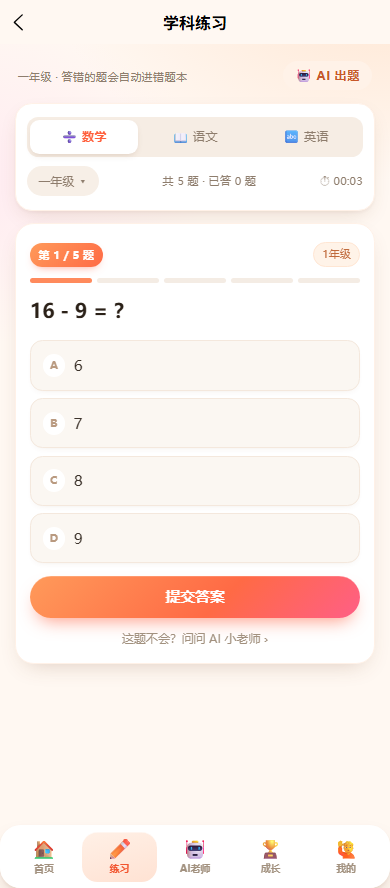
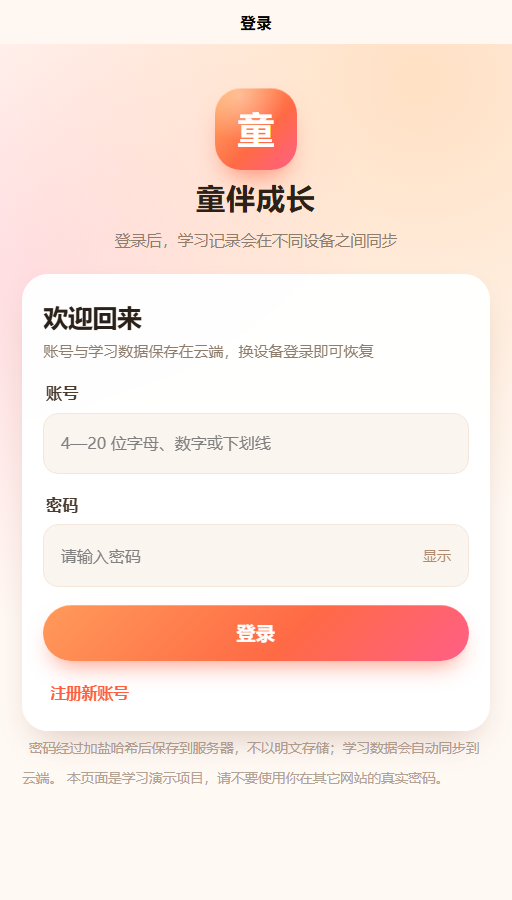

# 童伴成长 · AI 学习与亲子陪伴练习站

面向小学 **1—3 年级** 的 AI 学习助手与亲子陪伴练习站：学科练习、速算挑战、知识卡片、错题本、成长成就、亲子互评、家长报告，并支持**本机账号注册 / 登录**与多账号数据隔离。

前端基于 **uni-app + Vue 3**，内置一套**本地数据引擎**，所以可以**纯静态部署**（GitHub Pages 免费上线），不需要服务器和数据库；仓库里同时保留了可选的 FastAPI 后端与 Docker 部署方案。

<p>
  <a href="https://github.com/hewei-86/tongban_project/actions/workflows/deploy.yml"></a>
  <a href="https://hewei-86.github.io/tongban_project/"></a>
  
  
</p>

> **在线体验**：<https://hewei-86.github.io/tongban_project/>
>
> 打开即用，不登录也能以「游客」身份体验；注册本机账号后，每个账号有独立的学习记录，数据不会上传服务器。

<p>
  
  
  
</p>
<p>
  
  
  
</p>

---

## 目录

- [功能一览](#功能一览)
- [本机账号说明](#本机账号说明)
- [本地运行](#本地运行)
- [部署到 GitHub Pages（推荐）](#部署到-github-pages推荐)
- [目录结构](#目录结构)
- [数据与隐私](#数据与隐私)
- [可选：FastAPI 后端](#可选fastapi-后端)
- [构建微信小程序](#构建微信小程序)
- [测试](#测试)
- [常见问题](#常见问题)
- [后续计划](#后续计划)

---

## 功能一览

| 页面 | 能力 |
| --- | --- |
| 🏠 首页 | 每日签到、连续天数、今日任务进度、年级切换、孩子 / 家长视角切换、每日一句 |
| ✏️ 学科练习 | 数学 / 语文 / 英语 3 科 × 1—3 年级题库，逐题作答与讲解，答错自动进错题本；「AI 出题」在服务器部署时调用通义千问生成新题，纯静态环境自动回退本地题库 |
| ⚡ 速算挑战 | 60 秒限时口算，连击加分，最高分记录，成绩计入积分与成长曲线 |
| 📚 知识卡片 | 英语单词闪卡（点开看释义）、8 首古诗、10 个成语、收藏夹 |
| 🤖 AI 小老师 | 本地规则引擎：四则运算分步讲解、古诗背诵、成语释义、单词翻译、汉字加笔、情绪安抚；隐私与安全话题会自动拦截并引导找家长 |
| 📕 错题本 | 待掌握 / 已掌握筛选，重做判题，答对自动标记掌握，支持删除 |
| 🏆 我的成长 | 等级与经验、连续签到、28 天学习热力图、14 天学习曲线、14 个成就徽章、家庭成长榜、本周小结 |
| 💗 亲子互评 | 默契度、5 星评价、鼓励留言、互评记录 |
| 👨‍👩‍👧 家长中心 | 孩子概况、周报 / 月报、学科正确率、每日学习曲线、自动生成的小建议、学习目标、每日时长管理 |
| 🔐 登录 / 注册 | 本机账号注册、登录、退出；密码加盐哈希保存；每个账号独立数据；游客模式随时可用 |
| 🙋 我的 | 账号信息、角色切换、年级切换、数据导出 / 导入 / 重置、隐私与项目说明 |

设计上的几个小坚持：

- **不排名、不贴标签**：报告只描述趋势，并给出可执行的鼓励建议；
- **数据留在本机**：账号和学习记录都只存在浏览器里，不上传，也不收集真实的儿童个人信息；
- **AI 坦白身份**：明确告知「我是程序，不是真人老师」，重要知识提示再找家长或老师核对；
- **离线可用**：不依赖任何外部 API，弱网也能练习。

---

## 本机账号说明

登录 / 注册是为纯静态站点设计的**本机账号**，不是云端账号：

| 项目 | 说明 |
| --- | --- |
| 账号存储 | 浏览器本地（`tongban_accounts_v1`），不会上传 |
| 密码处理 | 随机盐 + **PBKDF2-SHA256（12 万次迭代）**，只保存哈希；不支持 WebCrypto 的环境退化为多轮加盐 SHA-256 |
| 登录态 | 记录当前账号 id（`tongban_auth_v1`），刷新页面仍保持登录 |
| 数据隔离 | 每个账号使用独立存储键，例如 `tongban_state_v1:acct_xxx`；账号之间的积分、错题、成长记录互不影响 |
| 游客模式 | 不登录也能用，使用默认的演示数据；注册新账号后从空白数据开始，游客数据仍保留 |
| 安全限制 | 连续输错 5 次密码会锁定 1 分钟 |
| 换设备 | **无法登录同一账号**（因为账号只在这台设备上）；换设备 / 清理浏览器数据后需要重新注册 |

> 这是学习与演示项目，请不要使用你在其它网站的真实密码。真正的跨设备登录、找回密码、监护人授权，需要接入后端账号系统（见「可选：FastAPI 后端」）。

---

## 本地运行

环境要求：**Node.js 20 LTS+**（本项目在 Node 24 上验证）。

```bash
cd frontend
npm install
npm run dev:h5      # 打开终端提示的本地地址（默认 http://localhost:5173）
```

打包静态站点：

```bash
npm run build:h5    # 产物在 frontend/dist/build/h5
```

本地预览打包结果（任选其一）：

```bash
npx serve dist/build/h5
# 或
python -m http.server 8080 --directory dist/build/h5
```

> 项目不需要配置 `.env`、数据库或 API Key，装完依赖即可使用。

---

## 部署到 GitHub Pages（推荐）

推送到 `main` 分支后，`.github/workflows/deploy.yml` 会自动构建并发布。

### 第一次部署（只需要做一次）

1. 把项目推到 GitHub 仓库（默认分支 `main`）。
2. 打开仓库 **Settings → Pages → Build and deployment**，把 **Source** 设为 **GitHub Actions**。
3. 回到 **Actions** 页面，等待 `Deploy to GitHub Pages` 跑完。
4. 访问：

```text
https://<你的用户名>.github.io/<仓库名>/
```

例如本仓库：<https://hewei-86.github.io/tongban_project/>

### 它是怎么处理子路径的

GitHub Pages 的「项目站点」部署在 `/<仓库名>/` 下，如果资源路径仍是 `/assets/...` 就会白屏。工作流会自动计算并注入：

```yaml
UNI_H5_BASE: /<仓库名>/
```

- 仓库名形如 `<用户名>.github.io` 时，自动使用根路径 `/`；
- 工作流还会写入 `.nojekyll` 和 `404.html` 兜底。

### 绑定自定义域名

在 **Settings → Pages → Custom domain** 填写域名后，站点会部署在根路径，此时需要把工作流里的 base 改成 `/`：

```yaml
# .github/workflows/deploy.yml 的 Resolve H5 base path 步骤
echo "value=/" >> "$GITHUB_OUTPUT"
```

### 部署后白屏 / 404 排查

| 现象 | 原因 | 处理 |
| --- | --- | --- |
| 打开空白、控制台 404 `/assets/...` | base 不对 | 确认上面「Source」为 GitHub Actions；重新运行工作流 |
| 页面 404 | Pages 未启用或分支不是 `main` | 检查 Settings → Pages；确认推送到 `main` |
| Actions 报 `Get Pages site failed` | Pages 还没开启 | 先按上面第 2 步开启，再重跑 |
| 样式正常但数据为空 | 浏览器清理了本地数据 | 正常现象，本地数据模式不做云端同步 |

---

## 目录结构

```text
tongban_project/
├─ frontend/                        # uni-app（Vue 3）前端
│  ├─ src/
│  │  ├─ pages/                     # 12 个页面
│  │  │  ├─ index/                  # 首页
│  │  │  ├─ practice/               # 学科练习
│  │  │  ├─ challenge/              # 速算挑战
│  │  │  ├─ cards/                  # 知识卡片
│  │  │  ├─ ai/                     # AI 小老师
│  │  │  ├─ wrongbook/              # 错题本
│  │  │  ├─ growth/                 # 成长档案
│  │  │  ├─ family/                 # 亲子互评
│  │  │  ├─ parent/                 # 家长中心
│  │  │  ├─ settings/               # 我的（含账号入口）
│  │  │  └─ auth/                   # 登录 / 注册
│  │  ├─ components/TabBar.vue      # 自定义底部导航（孩子 / 家长两套）
│  │  ├─ services/                  # 数据引擎、AI 小老师、账号与密码、会话、接口门面
│  │  │  ├─ auth.js                 # 注册 / 登录 / 退出 / 改密
│  │  │  ├─ accounts.js             # 本机账号列表
│  │  │  ├─ password.js             # PBKDF2 / SHA-256 密码处理
│  │  │  ├─ remoteAi.js             # 服务器「AI 出题」客户端（含本地回退）
│  │  │  └─ engine.js               # 账号可切换的数据引擎单例
│  │  ├─ data/                      # 题库、知识卡片数据
│  │  ├─ styles/app.css             # 设计系统（颜色、卡片、按钮、表单）
│  │  ├─ pages.json / manifest.json # 路由与打包配置
│  │  └─ App.vue / main.js
│  ├─ tests/                        # 27 项单测（引擎 + 账号密码）
│  └─ vite.config.js
├─ backend/                         # 可选：FastAPI 后端
│  ├─ main.py / models.py / schemas.py / database.py
│  ├─ test_api.py                   # 39 项接口自测
│  ├─ requirements.txt / Dockerfile
│  └─ .env.example
├─ nginx/nginx.conf                 # 可选：服务器部署用
├─ docker-compose.yml               # 可选：后端 + Nginx 一键启动
├─ docs/                            # README 预览图
└─ .github/workflows/
   ├─ deploy.yml                    # GitHub Pages 自动部署（默认）
   └─ deploy-server.yml             # 部署到自己的服务器（push main 自动 + 手动触发）
```

---

## 数据与隐私

- 学习数据保存在浏览器 **localStorage**；游客使用 `tongban_state_v1`，登录账号使用 `tongban_state_v1:acct_xxx`；刷新、关闭浏览器都不会丢；
- 本机账号列表在 `tongban_accounts_v1`，登录态在 `tongban_auth_v1`；密码只保存随机盐与哈希，不保存明文；
- 清理浏览器数据、换设备、无痕模式退出后会重新开始（这是纯静态方案的特点）；
- 「我的 → 本机数据」支持**导出备份 / 导入数据 / 重置**（作用于当前登录账号或游客数据）；
- AI 小老师完全在本地运行，**不会把对话发到任何服务器**；
- 项目不采集微信登录、手机号、真实姓名等个人信息，也没有把账号数据上传到云端。

> ⚠️ 如果要把它作为**面向真实儿童的产品**上线，还需要补充：后端账号体系、监护人授权与同意流程、隐私政策、内容安全审核、ICP 备案、未成年人保护与数据安全评估等。当前项目定位是学习与演示。

---

## 可选：FastAPI 后端

`backend/` 是一套与前端功能对应的 REST 接口（题库、答题、签到、错题、成长、报告、目标、亲子互评、速算挑战、通义千问 AI），默认使用 SQLite，可切换 MySQL。

### 本地启动

```bash
cd backend
uv sync                                   # 或者 python -m venv .venv && pip install -r requirements.txt
cp .env.example .env                      # 需要真实 AI 时再填 DASHSCOPE_API_KEY
uv run uvicorn main:app --reload --port 8000
```

- 健康检查：<http://127.0.0.1:8000/api/health>
- 接口文档：<http://127.0.0.1:8000/docs>

没有 `DASHSCOPE_API_KEY` 时，AI 接口会返回明确标注的演示回复，不影响其它功能。

### 启用真实 AI 出题（通义千问）

服务器部署时，练习页的「AI 出题」会自动调用后端，由通义千问按年级和学科生成新题：

1. 在 [阿里云百炼](https://bailian.console.aliyun.com/) 创建 API Key（需要开通百炼服务）；
2. 打开 GitHub 仓库 **Settings → Secrets and variables → Actions**，新建 Secret：`DASHSCOPE_API_KEY`；
3. 推送任意提交（或在 Actions 手动运行 **Deploy to Own Server**），工作流会把 Key 同步到服务器 `/data/myproject/.env` 并重启后端；
4. 打开服务器站点 →「练习」→「AI 出题」，成功时会提示“AI 已生成新题（通义千问）”。

说明：

- GitHub Pages 没有后端，会自动回退本地题库，不影响使用；
- 本地开发时 `npm run dev:h5` 会把 `/api` 代理到 `127.0.0.1:8000`，可以直接测试；
- 未配置 Key、额度不足或请求超时都会自动回退本地题库；
- 默认模型是 `qwen-turbo`，可在服务器 `.env` 中修改 `QWEN_MODEL`（例如 `qwen-plus`），费用以百炼控制台为准。

### 接口自测

```bash
cd backend
.venv\Scripts\python.exe test_api.py      # Windows
python test_api.py                        # macOS / Linux
```

脚本使用临时数据库，不会污染 `tongban.db`；当前覆盖 **39 项**检查。

### 用 Docker 部署到自己的服务器

服务器只需要：Linux（推荐 Ubuntu 22.04+）、Docker + Docker Compose、开放 80（有 HTTPS 时再加 443）。

```bash
# 在服务器上，进入项目目录后
docker compose up -d --build
```

- 前端静态文件由 Nginx 托管，`/api/` 反向代理到后端容器；
- 后端 **8000 端口不对外暴露**，只走容器内网，避免接口被直接扫描；
- 数据保存在 Docker 卷 `tongban-data` 中，重新部署不会丢；
- 访问 `http://<服务器IP>/` 即可；配置域名和 HTTPS 后访问 `https://<域名>/`。

需要域名 + HTTPS 时，可以用 Certbot 在宿主机签发证书，再把 443 反代到容器的 80；或者直接在 Nginx 配置里挂载证书。**HTTPS 还能让浏览器的 WebCrypto 可用**，本机账号的密码会使用更强的 PBKDF2。

需要服务器部署时，在仓库 Secrets 中配置 `SERVER_HOST`、`SERVER_USER`、`SERVER_SSH_KEY`（可选 `DEPLOY_PATH`，默认 `/data/myproject`）。配置完成后，**推送到 `main` 会自动部署到服务器**；也可以在 Actions 中手动运行 **Deploy to Own Server**。

> 自动部署会先跑前端单测，测试不通过就不会发布；部署任务串行执行，避免多个提交同时操作容器。

> 说明：当前前端默认使用**本地数据引擎 + 本机账号**，开箱即用；后端的定位是「后续做多设备同步 / 真实账号时的服务端」，目前还没有账号与 JWT 接口。如果你希望前端直接连后端，可以把 `frontend/src/services/api.js` 里的实现替换成 HTTP 请求，页面代码不需要改。

---

## 构建微信小程序

```bash
cd frontend
npm run build:mp-weixin
```

用微信开发者工具导入 `frontend/dist/build/mp-weixin`，在 `src/manifest.json` 填写自己的 `mp-weixin.appid`。

小程序端同样使用本机账号与本地数据；正式发布还需要配置合法域名、隐私协议与内容审核。

---

## 测试

前端（数据引擎、AI 规则、账号密码、等级算法、报告统计等）：

```bash
cd frontend
npm test
# 27 项全部通过（17 项引擎 + 10 项账号 / 密码）
```

后端（接口、判题、签到、错题、挑战、报告等）：

```bash
cd backend
.venv\Scripts\python.exe test_api.py
# 39 项全部通过
```

---

## 常见问题

**Q：为什么注册后学习数据是空的？**
A：登录账号从空白数据开始，避免把游客模式的示例记录算成自己的；游客数据仍然保留，退出登录就能回去。想保留游客记录，可以先在「我的 → 本机数据」导出，登录后再导入。

**Q：换一台设备还能登录同一个账号吗？**
A：不能。账号只保存在当前浏览器，纯静态站点没有服务器。要做跨设备登录，需要接入后端的账号系统（JWT / 会话），这是后续计划的一部分。

**Q：密码安全吗？忘记密码怎么办？**
A：密码使用随机盐 + PBKDF2-SHA256 处理后保存在本机，不存明文；这是演示项目，请不要用真实密码。因为没有服务器和找回渠道，忘记密码后只能退出账号、重新注册（原有学习数据仍保留在本地，但需要重新积累）。

**Q：为什么不需要后端？数据存在哪里？**
A：前端内置 `src/services/engineCore.js`，把题目、记录、错题、积分、成就、报告都算在浏览器本地，并持久化到 localStorage。好处是零成本、零配置、隐私友好；代价是不能多设备同步。

**Q：AI 小老师是真的 AI 吗？**
A：演示站里的 AI 是**本地规则引擎**，能真的算对四则运算并讲步骤、背古诗、讲成语、查单词，但不是大模型。后端配置 `DASHSCOPE_API_KEY` 后，同一套接口会调用通义千问。

**Q：如何添加自己的题目？**
A：编辑 `frontend/src/data/questions.js` 的 `QUESTION_BANK`，按现有结构追加即可（学科、年级、题干、答案、解析、选项）。

**Q：如何调整年级范围？**
A：目前面向 1—3 年级。题库、任务模板、卡片数据分别集中在 `src/data/` 和 `src/services/engineCore.js`，扩展年级时同步补数据即可。

**Q：手机上能用吗？**
A：可以，是响应式 H5；也可以「添加到主屏幕」当作轻量 App 使用。

---

## 后续计划

- [ ] 后端账号体系（注册 / 登录 / JWT）与多设备同步
- [ ] 多孩子 / 多家庭成员
- [ ] 忘记密码与账号迁移（导出账号包）
- [ ] PWA 离线安装与消息提醒
- [ ] 语音朗读（古诗、单词）
- [ ] 家长报告导出 PDF
- [ ] 更丰富的题库与自适应难度

---

## 说明

本项目用于学习、课程设计与演示，不替代学校教学，也不对 AI 生成内容的准确性作保证。欢迎提 Issue 或 PR 一起完善。
